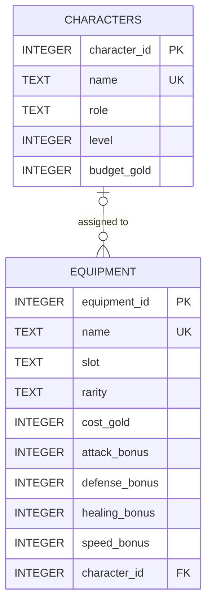

# Guild of the Nemorensis — Gear Audit

A small, reproducible SQLite database that audits an adventuring guild's equipment: who is under-equipped, who is over budget, and how strong each character's loadout is for their role.

> **Status: work in progress.** The schema, seed data, build pipeline, and first analysis view are complete. The analysis queries and the test suite are next.

## What it does

The guild has a roster of characters and a vault of equipment. Each item is either assigned to one character or sits unassigned in the vault. A character may have at most one item per slot.

The project builds a database from two hand-authored CSV files, enforces the guild's rules in the schema, and exposes a view that summarises each character's loadout:

- items equipped
- total gear cost
- remaining budget
- filled and empty slots
- a role-weighted power score

The goal is an audit you can run again after every change, not a one-off spreadsheet.

## Quick start

Requires Python 3.12+ and SQLite 3.37+ (for `STRICT` tables).

```bash
python3 src/build_db.py
```

The build deletes any existing `guild.db`, applies the schema, creates the views, loads both CSVs, and runs two whole-database health checks. It fails rather than leave a broken database behind.

Then query it:

```bash
sqlite3 -header -column guild.db \
  "SELECT name, role, role_power FROM v_character_loadout ORDER BY role_power DESC;"
```

```text
name    role    role_power
------  ------  ----------
Brabby  Tank    80
Jill    Healer  50
Santos  Damage  50
```

## Current dataset

Three characters and twelve items, enough to exercise every rule while the pipeline is built. Seven items are equipped; five are in the vault. The finished dataset will have 12 characters and 40 items.

All data is synthetic and hand-authored. No copyrighted game data is used.

## Schema

Two tables:



The relationship is optional one-to-many:

- one character to zero or many items;
- one item to zero or one character.

`equipment.character_id IS NULL` means the item is in the vault. `ON DELETE SET NULL` returns a deleted character's gear to the vault instead of deleting it.

The guild's rules are enforced in the schema, not only in Python:

- `STRICT` tables, so a string cannot enter an integer column;
- `UNIQUE COLLATE NOCASE` on names, so `Aria` and `aria` collide;
- `CHECK` constraints for roles, slots, rarities, levels, budgets, costs, and stat ranges;
- a foreign key for ownership;
- a partial unique index for one equipped item per slot:

```sql
CREATE UNIQUE INDEX ux_equipment_one_per_slot
ON equipment(character_id, slot)
WHERE character_id IS NOT NULL;
```

The `WHERE` clause is what lets the vault hold many items in the same slot while a character can equip only one.

## Design decisions

**Why only two tables?** Each item is a unique physical object owned by at most one character. That is one-to-many, and one-to-many belongs in a foreign key on the many side. The vault is the absence of an assignment, not an entity. A loadout is derived by grouping, not stored.

**Why a partial index?** The one-per-slot rule applies only to equipped items. Vault items have no character, so they must be exempt.

**What "power" means.** `role_power` is a transparent guild heuristic, not a combat simulation:

| Role | Weighted stats |
|---|---|
| Tank | `defense * 3 + attack + speed` |
| Healer | `healing * 3 + defense + speed` |
| Damage | `attack * 3 + speed` |
| Support | `healing * 2 + speed * 2 + defense` |

The weights live in one view, so they are easy to inspect and change.

**What it does not do.** No combat simulation, item history, shared items, multiple loadout plans, market prices, or combinatorial optimiser. Recommendations are per slot. These are deliberate scope boundaries.

## Project structure

```text
guild-of-the-nemorensis/
├── data/               # characters.csv, equipment.csv
├── docs/               # brief, glossary, conceptual model, data dictionary
├── sql/                # schema.sql, views.sql
├── src/                # build_db.py
├── README.md
├── LICENSE
└── requirements.txt
```

## Roadmap

- [x] Conceptual model, business rules, and data dictionary
- [x] SQLite schema with enforced constraints
- [x] CSV seed data and a repeatable Python build
- [x] Whole-database health checks after the build
- [x] `v_character_loadout` with role-weighted power
- [ ] Eight analysis queries
- [ ] pytest suite covering schema, constraints, data quality, and queries
- [ ] Defect log with regression tests
- [ ] Expand the dataset to 12 characters and 40 items

## Documentation

- [Project brief](docs/00_project_brief.md)
- [Glossary](docs/01_glossary.md)
- [Conceptual model](docs/02_conceptual_model.md)
- [Data dictionary](docs/03_data_dictionary.md)

## License

Code is released under the [MIT License](LICENSE).

The synthetic seed data in `data/` is released under CC0 1.0. See [data/README.md](data/README.md).
