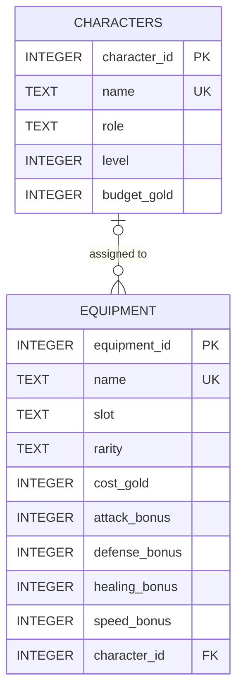

# Guild of the Nemorensis — Gear Audit

A small, reproducible SQLite database that audits an adventuring guild's
equipment: who is under-equipped, who is over budget, and which vault item is
the best affordable upgrade for each empty slot.

> **Status: complete for the planned scope.** 12 characters, 40 items, 8
> analysis queries, and 50 passing tests. The code is MIT; the synthetic data
> is CC0.

This is a portfolio project for QA and data-analyst roles. It is deliberately
small: two tables, one build command, eight queries, and a test suite that
tries to break the data. The point is not volume; it is evidence of clear
requirements, a defensible schema, enforced data quality, and tested queries.

## What it does

The guild has a roster of characters and a vault of equipment. Each item is
either assigned to one character or sits unassigned in the vault. A character
may have at most one item per slot.

The build loads two hand-authored CSV files, enforces the guild's rules in the
schema, and creates a view that summarises each character's loadout:

- items equipped;
- total gear cost;
- remaining budget and budget status;
- filled and empty slots;
- a role-weighted power score;
- power per 100 gold spent.

Eight queries then answer the quartermaster's questions: who needs attention,
who is strongest for their role, which vault items are the best value, and what
each character should buy next.

## Quick start

Requires Python 3.12+ and SQLite 3.37+ (for `STRICT` tables).

```bash
python3 -m venv .venv
.venv/bin/pip install -r requirements.txt

python3 src/build_db.py
.venv/bin/python -m pytest -q
```

Expected final line:

```text
50 passed
```

Query the result:

```bash
sqlite3 -header -column guild.db \
  "SELECT name, role, role_power, budget_status
   FROM v_character_loadout
   ORDER BY role_power DESC;"
```

```text
name     role     role_power  budget_status
-------  -------  ----------  -------------
Orla     Tank     144         Over
Brabby   Tank     80          Under
Rook     Damage   78          Over
Tamsin   Support  66          Over
Vexa     Damage   59          At
Jill     Healer   50          Over
Santos   Damage   50          Under
Maelin   Healer   49          Under
Ysolde   Healer   43          Under
Nia      Support  37          Under
Halvard  Tank     32          At
Corin    Support  0           Under
```

## Current dataset

| Entity | Count |
|---|---:|
| Characters | 12 |
| Roles | 4 (Tank, Healer, Damage, Support) |
| Equipment items | 40 |
| Slots | 7 |
| Rarities | 5 |
| Equipped items | 26 |
| Vault items | 14 |

The data is designed to exercise the rules, not to look realistic:

- three characters per role, so within-role rankings are meaningful;
- one character with no gear (Corin), to exercise `LEFT JOIN`, `COUNT`,
  `COALESCE`, and empty slots;
- characters who are over, at, and under budget;
- at least one vault item in every slot, so every slot has a possible upgrade;
- a mix of affordable and unaffordable upgrades.

All data is synthetic and hand-authored. No copyrighted game data is used.

## Schema

Two tables:



The relationship is optional one-to-many:

- one character to zero or many items;
- one item to zero or one character.

`equipment.character_id IS NULL` means the item is in the vault. `ON DELETE
SET NULL` returns a deleted character's gear to the vault instead of deleting
it.

The guild's rules are enforced in the schema, not only in Python:

- `STRICT` tables, so a string cannot enter an integer column;
- `UNIQUE COLLATE NOCASE` on names, so `Aria` and `aria` collide;
- `CHECK` constraints for roles, slots, rarities, levels, budgets, costs, and
  stat ranges;
- a foreign key for ownership;
- a partial unique index for one equipped item per slot:

```sql
CREATE UNIQUE INDEX ux_equipment_one_per_slot
ON equipment(character_id, slot)
WHERE character_id IS NOT NULL;
```

The `WHERE` clause is what lets the vault hold many items in the same slot
while a character can equip only one.

## Analysis queries

The eight queries live in `sql/queries/`. Their full outputs are in
[`docs/08_query_results.md`](docs/08_query_results.md).

| # | Question | Technique | File |
|---|---|---|---|
| 1 | Who is under-equipped or over budget? | view, `CASE`, `WHERE` | [`01_loadout_audit.sql`](sql/queries/01_loadout_audit.sql) |
| 2 | Who is strongest for their role? | `RANK()`, `PARTITION BY` | [`02_role_power_ranking.sql`](sql/queries/02_role_power_ranking.sql) |
| 3 | Which vault items are the best value per gold, by slot and role? | CTE, `CROSS JOIN`, `ROW_NUMBER()` | [`03_vault_value_by_role.sql`](sql/queries/03_vault_value_by_role.sql) |
| 4 | What is the best affordable next upgrade for each empty slot? | CTE, `NOT EXISTS`, `ROW_NUMBER()` | [`04_best_affordable_upgrade.sql`](sql/queries/04_best_affordable_upgrade.sql) |
| 5 | Does the data obey the guild's rules? | `UNION ALL`, aggregate checks | [`05_data_quality_checks.sql`](sql/queries/05_data_quality_checks.sql) |
| 6 | How many characters are over, at, or under budget? | `GROUP BY`, aggregates | [`06_budget_summary.sql`](sql/queries/06_budget_summary.sql) |
| 7 | How does each role compare? | `GROUP BY`, conditional aggregate | [`07_role_summary.sql`](sql/queries/07_role_summary.sql) |
| 8 | What is sitting in the vault, and where is the gold? | CTE, `RANK()`, scalar subquery | [`08_vault_composition.sql`](sql/queries/08_vault_composition.sql) |

Run one directly:

```bash
sqlite3 -header -column guild.db < sql/queries/02_role_power_ranking.sql
```

The recommendation query is deliberately per slot, not a combinatorial
optimiser. It answers: *for this empty slot and this budget, which vault item
gives the most role power?* It does not try to find the best combination of
items across the whole loadout.

## Testing

The suite has **50 tests** across five layers:

| Layer | File | Tests | What it proves |
|---|---|---:|---|
| Schema | `tests/test_schema.py` | 5 | Tables, view, `STRICT`, foreign key |
| Constraints | `tests/test_constraints.py` | 20 | Invalid data is rejected; deletion is safe |
| Data quality | `tests/test_data_quality.py` | 12 | Seed data is healthy; view arithmetic is correct |
| Queries | `tests/test_queries.py` | 8 | Every query runs and returns expected results |
| Build pipeline | `tests/test_build.py` | 5 | Build is reproducible; failed builds are safe |

```bash
.venv/bin/python -m pytest -q
```

```text
50 passed
```

The tests execute the `.sql` query files directly, so the documentation and the
code cannot drift apart silently. The full plan is in
[`docs/05_test_plan.md`](docs/05_test_plan.md).

## Defect log

Four real defects were found and fixed during the build. Each has a regression
test in the suite:

| ID | Defect | Fix |
|---|---|---|
| D-01 | `COUNT(*)` counted a gearless character as having one item | `COUNT(e.equipment_id)` |
| D-02 | Rebuilding deleted the loadout view | Run `sql/views.sql` during the build |
| D-03 | A failed build destroyed the previous good database | Build to a temp file; `os.replace` only after checks pass |
| D-04 | Unknown CSV name raised a bare `KeyError` | Report the file, line, and bad value |

Read the details in [`docs/06_defect_log.md`](docs/06_defect_log.md).

## Design decisions

**Why only two tables?** Each item is a unique physical object owned by at most
one character. That is one-to-many, and one-to-many belongs in a foreign key on
the many side. The vault is the absence of an assignment, not an entity. A
loadout is derived by grouping, not stored.

**Why a partial index?** The one-per-slot rule applies only to equipped items.
Vault items have no character, so they must be exempt.

**What "power" means.** `role_power` is a transparent guild heuristic, not a
combat simulation:

| Role | Weighted stats |
|---|---|
| Tank | `defense * 3 + attack + speed` |
| Healer | `healing * 3 + defense + speed` |
| Damage | `attack * 3 + speed` |
| Support | `healing * 2 + speed * 2 + defense` |

The weights live in one view, so they are easy to inspect and change. The same
item can be worth different amounts to different roles.

**Why build to a temporary file?** The build deletes and recreates the database.
If it wrote directly to `guild.db` and then failed, the last good database would
be lost. The build now writes `guild.db.tmp`, runs `PRAGMA foreign_key_check`
and `PRAGMA integrity_check`, and only then replaces the target. A failed build
leaves the previous database untouched.

**What it does not do.** No combat simulation, item history, shared items,
multiple loadout plans, market prices, or combinatorial optimiser.
Recommendations are per slot. These are deliberate scope boundaries.

## What I learned

- **Outer joins change what `COUNT` means.** `COUNT(*)` counted a gearless
  character as one item because the `LEFT JOIN` produced a blank row.
  `COUNT(equipment_id)` counts real items, not rows.
- **Constraints are executable requirements.** A rule written in a document is
  a hope; a `CHECK`, `UNIQUE` index, or foreign key is a rule the database
  enforces.
- **A build is not reproducible if part of it is manual.** The view originally
  lived only in the SQLite shell, so a rebuild deleted it. Moving `views.sql`
  into the build fixed that.
- **Failure paths deserve tests.** The most useful test in the suite is the one
  that proves a broken CSV cannot destroy the last good database.
- **Window functions are worth the learning curve.** `RANK()` and
  `ROW_NUMBER()` answer "best per group" questions without a pile of Python.

## Project structure

```text
guild-of-the-nemorensis/
├── data/                  # characters.csv, equipment.csv
├── docs/                  # brief, glossary, model, dictionary, test plan,
│                          # defect log, interview notes, query results
├── sql/
│   ├── schema.sql         # tables, constraints, partial unique index
│   ├── views.sql          # v_character_loadout
│   └── queries/           # eight analysis queries
├── src/
│   └── build_db.py        # atomic CSV-to-SQLite build
├── tests/                 # 50 pytest tests
├── README.md
├── LICENSE
└── requirements.txt
```

## Roadmap

- [x] Conceptual model, business rules, and data dictionary
- [x] SQLite schema with enforced constraints
- [x] CSV seed data and a repeatable Python build
- [x] Whole-database health checks after the build
- [x] `v_character_loadout` with role-weighted power and budget status
- [x] Eight analysis queries
- [x] 50-test pytest suite covering schema, constraints, data quality, queries, and the build
- [x] Defect log with four regression-tested defects
- [x] Expand the dataset to 12 characters and 40 items
- [x] README, query outputs, LinkedIn post, and CV bullets

## Documentation

- [Project brief](docs/00_project_brief.md)
- [Glossary](docs/01_glossary.md)
- [Conceptual model](docs/02_conceptual_model.md)
- [Data dictionary](docs/03_data_dictionary.md)
- [Test plan](docs/05_test_plan.md)
- [Defect log](docs/06_defect_log.md)
- [Interview notes](docs/07_interview_notes.md)
- [Query results](docs/08_query_results.md)

## License

Code is released under the [MIT License](LICENSE).

The synthetic seed data in `data/` is released under CC0 1.0. See
[data/README.md](data/README.md).
