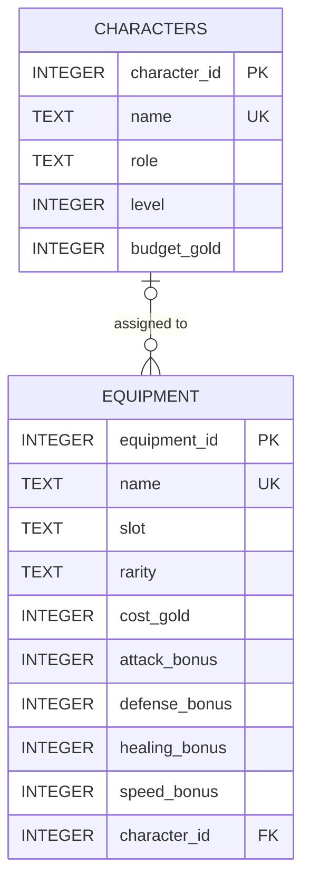

# Conceptual Data Model — Guild of the Nemorensis

| Field | Value |
|---|---|
| Status | Complete; implemented in `sql/schema.sql` |
| Scope | Conceptual model only; SQLite types and constraints live in the schema |
| Related documents | `00_project_brief.md`, `03_data_dictionary.md`, `sql/schema.sql` |

This document describes the domain in business terms, independent of SQLite. It follows a conventional conceptual-model pattern: domain of discourse, entities and attributes, relationships, business rules, assumptions, and limitations.

## 1. Domain of discourse

The Guild of the Nemorensis is a small adventuring guild. It has 12 members. Each member has a unique name, one role (Tank, Healer, Damage, or Support), a level from 1 to 60, and a gear budget in gold.

The guild owns 40 unique equipment items. Each item has a unique name, one slot, one rarity, a cost in gold, and bonuses to attack, defense, healing, and speed.

An item is either assigned to one character or unassigned in the guild vault. A character can have at most one item per slot. The vault is not a separate entity; it is simply the set of items with no assignment. A loadout is not a separate entity; it is the set of items currently assigned to a character.

The quartermaster wants a repeatable audit: who is under-equipped, who is over budget, which items are best value, and what affordable upgrade should be considered next.

## 2. Purpose and scope

The database supports five decisions:

1. Which characters have empty slots?
2. Which characters are over budget?
3. Which characters have the strongest current loadout for their role?
4. Which unassigned items are the best value per slot?
5. Which affordable vault item is the best next upgrade for an empty slot?

It does not simulate combat, store item history, or search every possible combination of items. Those are deliberate exclusions, documented in section 7.

## 3. Entities and attributes

### 3.1 Character

**Definition:** A named member of the guild who can be assigned equipment.

| Attribute | Meaning | Required? |
|---|---|---|
| Identifier | A stable, artificial identifier for the character. | Yes |
| Name | The character's display name. Unique, trimmed, case-insensitive. | Yes |
| Role | The character's combat role: Tank, Healer, Damage, or Support. | Yes |
| Level | Experience level from 1 to 60. Recorded for context, not used in the power formula. | Yes |
| Gear budget | The maximum gold the guild will tie up in this character's equipment. | Yes |

A character may have zero equipment items. A character may have at most one item per slot.

### 3.2 Equipment item

**Definition:** A unique physical item owned by the guild, with a slot and stat bonuses.

| Attribute | Meaning | Required? |
|---|---|---|
| Identifier | A stable, artificial identifier for the item. | Yes |
| Name | The item's display name. Unique, trimmed, case-insensitive. | Yes |
| Slot | Weapon, Off-hand, Head, Chest, Legs, Feet, or Accessory. | Yes |
| Rarity | Common, Uncommon, Rare, Epic, or Legendary. | Yes |
| Cost | The item's value in gold. | Yes |
| Attack bonus | Attack stat added when equipped. | Yes (default 0) |
| Defense bonus | Defense stat added when equipped. | Yes (default 0) |
| Healing bonus | Healing stat added when equipped. | Yes (default 0) |
| Speed bonus | Speed stat added when equipped. | Yes (default 0) |
| Assignment | The character currently holding the item, or none. | No |

An item is either in the vault or assigned to exactly one character. It cannot be assigned to two characters at once. An item can exist with no assignment.

### 3.3 What is not a separate entity

This is a deliberate part of the model, not an omission.

| Thing | Why it is not a table | What it is instead |
|---|---|---|
| Vault | It has no attributes of its own; it is just the absence of an assignment. | `equipment.character_id IS NULL`. |
| Loadout | It is derived from the items currently assigned to a character. | `GROUP BY character_id`. |
| Assignment | It is a single link, not a thing with its own attributes. | The `character_id` foreign key on `equipment`. |
| Role | A fixed list for the MVP. A lookup table would add flexibility but not value yet. | `CHECK (role IN (...))` in the logical model. |
| Slot | A fixed list for the MVP. | `CHECK (slot IN (...))`. |
| Rarity | A fixed list for the MVP, descriptive only. | `CHECK (rarity IN (...))`. |

If the guild later needs item history, shared items, or multiple loadout plans, these things become tables. Section 10 shows the changes.

## 4. Relationship and cardinality

There is one relationship: **a character can be assigned equipment**.

| Direction | Cardinality | Meaning |
|---|---|---|
| Character → Equipment | 1 to 0..* | A character can have zero or many items. |
| Equipment → Character | 0..1 to 1 | An item is either in the vault or assigned to exactly one character. |

This is an **optional one-to-many** relationship. The foreign key lives on the "many" side: `equipment.character_id`.

The rule "a character has at most one item per slot" is a **business rule**, not a cardinality of the relationship. It is enforced by a partial unique index in the schema.

## 5. Business rules

| ID | Rule | Why it matters |
|---|---|---|
| BR-01 | Each character has a unique display name. Names are compared case-insensitively and must be trimmed and non-empty. | Prevents duplicate identities and invisible duplicates such as `Aria` and `aria `. |
| BR-02 | Each character has exactly one role from Tank, Healer, Damage, Support. | The role drives the power weights. |
| BR-03 | Each character has an integer level from 1 to 60. | Keeps level meaningful and testable. |
| BR-04 | Each character has an integer gear budget greater than or equal to 0. | Budget comparisons need a non-negative cap. |
| BR-05 | Each equipment item has a unique name. Names are compared case-insensitively and must be trimmed and non-empty. | Prevents duplicate items and invisible duplicates. |
| BR-06 | Each item has exactly one slot from the seven allowed values. | A slot determines where the item can be equipped. |
| BR-07 | Each item has exactly one rarity from the five allowed values. | Keeps the data consistent for reporting. |
| BR-08 | Each item has an integer cost greater than 0. | Value-per-gold queries need a positive denominator. |
| BR-09 | Each stat bonus is an integer greater than or equal to 0, and at least one bonus is greater than 0. | An item with no effect is not useful. |
| BR-10 | An item is assigned to at most one character. | The item is a unique physical object. |
| BR-11 | A character has at most one item per slot. | Prevents double-equipping the same slot. |
| BR-12 | Deleting a character returns their items to the vault. | Gear is guild property, not character property. |
| BR-13 | An item cannot reference a character that does not exist. | Prevents orphaned gear. |
| BR-14 | A character can have zero items, and an item can be unassigned. | Supports new members and the vault. |

## 6. Assumptions

- Item stat bonuses are additive. There are no set bonuses or synergies.
- The role weights are guild doctrine, not objective game truth. They are transparent and live in one view.
- Gold amounts are whole numbers. There are no taxes, discounts, or market fluctuations.
- Each item is unique. There are no quantities or stacks.
- A character's level is recorded for context and is not a multiplier on item stats.
- The vault has no location or keeper; it is simply unassigned gear.
- The current assignment is the only assignment history we store.
- There are no character abilities, spells, consumables, or quests.
- All names and lore are original or used with permission. No copyrighted game data is included.

## 7. Limitations

- No combat simulation. `role_power` is a heuristic, not a prediction.
- No item history or audit trail.
- No multiple copies of the same item.
- No item sharing between characters.
- No multiple loadout plans per character.
- No market prices, taxes, discounts, or consumables.
- No true combinatorial optimiser. Recommendations are per slot, not a full knapsack solution.
- No level normalisation. A high-level character may outrank a low-level one because they have more gear. Rankings should be read with level in mind.
- No web app, authentication, API, or multi-user access.
- Synthetic data. This is not a live game or a real guild.

## 8. Conceptual ERD

**How to read it:** one character can be associated with zero or more equipment items; each equipment item is associated with zero or one character. The `|o` on the character side is the optional assignment: an item can be in the vault. The `o{` on the equipment side is the many side: a character can own several items.

`PK` = primary key, `FK` = foreign key, `UK` = unique key.

## 9. Why two tables?

Each equipment item is a unique physical object. It can be in the vault or assigned to one character, but never to two characters at once. A character can have many items. That is a one-to-many relationship, and one-to-many is represented by a foreign key on the many side. A junction table is not needed.

Keeping the vault as `character_id IS NULL` and the loadout as `GROUP BY character_id` means we do not duplicate character details on every item row, and we do not need a third table to answer the core questions.

The trade-off is that the model cannot represent shared items, item history, or multiple loadout plans. Those are documented limitations and candidates for version 2. For this project, two tables are the honest minimum, not a shortcut.

## 10. What would change if...

| New requirement | Model change |
|---|---|
| Items can be shared across characters | Add a `character_equipment` junction table and move the assignment there. |
| Multiple loadout plans per character | Add `loadout` and `loadout_item` tables. |
| Item assignment history | Add an `assignment_history` table with `assigned_at` and `returned_at`. |
| Role weights stored as data | Add a `roles` table with weight columns and join to it. |
| More roles, slots, or rarities | Replace `CHECK` lists with lookup tables. |
| Market prices over time | Add `item_price_history`. |
| Multiple copies of an item | Add an `item_instance` table or a quantity column, depending on whether copies are interchangeable. |
| A true best-loadout optimiser | Add loadout-plan tables and/or a Python solver. |

These are interview talking points: knowing what you deliberately excluded is as important as knowing what you built.

## 11. Data quality requirements

- The clean seed data must pass `PRAGMA integrity_check` with `ok`.
- `PRAGMA foreign_key_check` must return no rows.
- No duplicate character or item names, including case-only differences.
- No leading or trailing whitespace in names.
- No orphaned equipment.
- No character with two items in the same slot.
- No negative budgets, costs, or stat bonuses.
- No item with all stats at zero.
- No invalid role, slot, or rarity.
- Invalid data belongs in test fixtures, not in the seed data.
- Every business rule must have a test that tries to break it.
- Query results must have known expected values for the fixture data.

## 12. Sign-off checklist

- [x] Domain narrative agreed.
- [x] Entities and attributes agreed.
- [x] Relationship and cardinality agreed.
- [x] Business rules agreed.
- [x] Assumptions and limitations agreed.
- [x] Two-table decision agreed.
- [x] Logical model, schema, and ERD implemented in `sql/schema.sql` and the README.
